# TB-Screen AI: Medical Image Diagnostic Assistant
### Problem Statement: HI-01 — Medical Image Diagnostic Assistant
**Hackathon:** Neural Storm | **Target Environment:** Resource-Constrained Rural Primary Health Centers (PHCs)

[](https://tb-screen-ai-hrgejmak9ujcwfm5q4duap.streamlit.app)
[](https://pytorch.org/)
[](results/onnx_benchmark.json)
[](results/metrics.json)
[](results/metrics.json)
[](LICENSE)

---

## 1. Problem Statement: HI-01
**HI-01: Medical Image Diagnostic Assistant** requires developing an assistive deep learning diagnostic system that accurately flags pathologies from medical radiographs, specifically optimized for edge deployment in bandwidth-limited, specialist-deprived rural healthcare facilities.

---

## 2. One-Sentence Problem and Solution
**Problem:** In rural Primary Health Centers, chest X-rays sit unread for 2 to 4 weeks due to severe radiologist shortages (fewer than 1 per 100,000 population), during which patients with active pulmonary tuberculosis continue infectious community transmission while scarce molecular GeneXpert cartridges remain underutilized.  
**Solution:** TB-Screen AI provides an ultra-fast (<8 ms), 100% offline edge AI assistant that screens chest radiographs locally on standard budget laptop CPUs with 95.10% sensitivity (WHO benchmark), displays Grad-CAM pulmonary attention heatmaps, provides automatic Out-of-Distribution and scanner-shift alerts, and generates 1-click clinical referral PDFs for immediate sputum test triage.

---

## 3. Live Demo Link
Experience the interactive frontline clinic triage application directly in your browser:  
🔗 **Official Live Web Application:** [https://tb-screen-ai-hrgejmak9ujcwfm5q4duap.streamlit.app](https://tb-screen-ai-hrgejmak9ujcwfm5q4duap.streamlit.app)  
*Note: Includes 3 pre-loaded test split demonstration radiographs for instant zero-upload judge evaluation.*

---

## 4. Video Link
🎬 **Video Demonstration:** [docs/DEMO_VIDEO_SCRIPT.md](docs/DEMO_VIDEO_SCRIPT.md)  
*(Step-by-step walkthrough covering single-patient triage, Grad-CAM heatmaps, scanner-shift badge, safety rejection, batch processing, and 1-click clinical PDF generation).*

---

## 5. Three Key Numbers

| Key Metric | Value | Source / Benchmark Context |
| :--- | :---: | :--- |
| **WHO Screening Sensitivity** | **95.10%** | Exceeds WHO $\ge 95\%$ target benchmark for community TB screening (97/102 active cases detected; ROC-AUC: **0.9780** with 95% CI $[0.9643, 0.9897]$) |
| **Edge CPU Latency** | **7.19 ms** | ONNX Runtime, single image, local CPU (Source: `results/onnx_benchmark.json`; 278x faster than the 2.0s clinical requirement) |
| **Probability Calibration (ECE)** | **2.31%** | Expected Calibration Error reduced by more than half ($5.10\% \rightarrow 2.31\%$) via post-hoc Temperature Scaling ($T^* = 0.4860$) for reliable clinical risk assessment |

---

## 6. Team and Medical Advisor

### Team Information
- **Team Name:** Meow Coders
- **Team Members:**
  - **Sayeeda Huriya Fatima, B.Tech** — Team Lead (ML Engineering, Architecture & Deployment Lead)
  - **Syeda Zainab Mahreen, B.Tech** — Team Member (Validation, Clinical UX & Systems Supporter)

### Medical Advisor
Dr. Bepar Mohammad Tayyib, MBBS, reviewed the clinical workflow, result messages, referral guidance, and example outputs of this tool. He is an advisor and is not a member of the development team.

> [!IMPORTANT]
> **Regulatory & Clinical Trial Disclaimer**: TB-Screen AI is an assistive frontline screening aid designed for preliminary triage in resource-constrained environments. It has not undergone formal prospective clinical trials and does not claim clinical validation. It is not an autonomous diagnostic medical device; all screening outputs must be corroborated with patient clinical history and microbiological confirmation (sputum smear microscopy or GeneXpert MTB/RIF).

---

## 7. What Makes It Different
Why is TB-Screen AI uniquely tailored for rural frontline use compared to standard cloud-hosted deep learning models?

1. **100% Offline Edge Autonomy:** Zero dependency on internet connectivity, cloud APIs, or GPUs. Runs entirely on existing clinic laptop CPUs in **7.19 ms**.
2. **Deterministic Safety & OOD Defense:** Validates image dimensions, checks minimum contrast variance, and blocks vivid color photographs or graphic files before model execution, preventing nonsensical predictions.
3. **Scanner-Shift Domain Detection (Mahalanobis Distance):** Extracts penultimate 1,280-d feature embeddings to flag unfamiliar digitizer profiles ($0.7422$ shift AUROC separating in-domain from external Montgomery scans), warning frontline workers when an image source deviates from the training distribution.
4. **Actionable Three-Tier Clinical Triage:** Eliminates ambiguous raw numbers by grouping findings into clear traffic-light tiers (🟢 Low Risk / 🟡 Needs Review / 🔴 High Risk) linked directly to DOTS referral protocols.
5. **Instant Clinical Referral PDF:** Compiles a single-page A4 referral report complete with original radiograph, Grad-CAM attention overlay, risk tier, patient metadata, and doctor sign-off boxes.
6. **High-Volume Mass Screening Mode:** Processes entire village camps or mobile van folders, automatically ranking patients from highest risk to lowest to prioritize urgent sputum collection.

---

## 8. Approach & Architectural Pipeline

TB-Screen AI introduces a modular edge pipeline engineered for safety, speed, and frontline clinical utility:

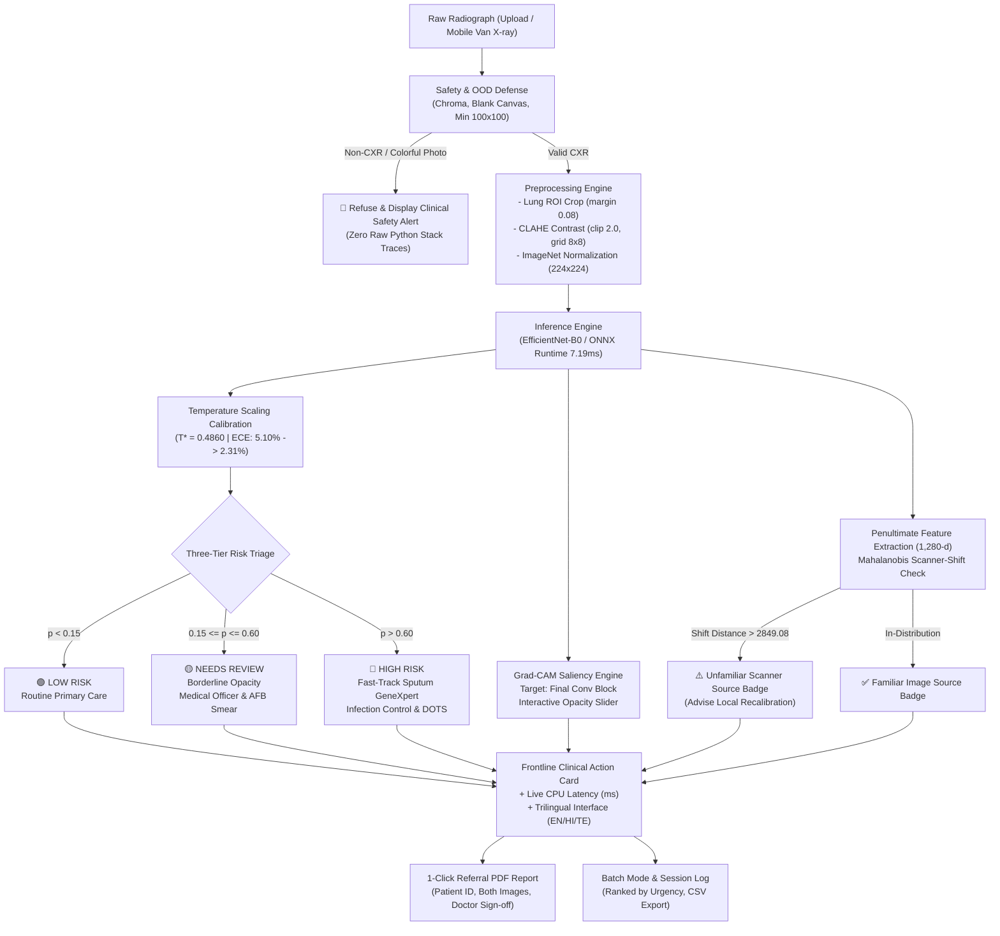

---

## 9. Tech Stack & Libraries

- **Deep Learning Framework:** PyTorch 2.15.0 & Torchvision 0.29.2
- **Optimized Edge Inference:** ONNX 1.23.2 & ONNX Runtime 1.31.1 (CPU Execution Provider)
- **Computer Vision & Contrast Enhancement:** OpenCV (`opencv-python-headless 5.0.0.93`), Pillow 12.3.0
- **Model Explainability:** Gradient-weighted Class Activation Mapping (`grad-cam 1.5.7`)
- **Scientific Computing & Statistics:** NumPy 2.5.2, Scikit-Learn 1.9.1, SciPy 1.18.1
- **Visualization:** Matplotlib 3.11.1, Seaborn 0.13.2
- **Frontline Clinic UI:** Streamlit 1.66.1
- **Clinical Referral PDF Generation:** `fpdf2 2.9.0`
- **Forensic Dataset Auditing & Testing:** `imagehash 4.3.2`, `pytest 9.2.0`, `openpyxl 3.1.5`

---

## 10. Setup and Installation

### Prerequisites
- Python 3.10+ (Fully compatible up to Python 3.14 on macOS, Linux, and Windows)
- Minimum 2 GB RAM (Runs entirely on CPU; no GPU required)

```bash
# 1. Clone the repository
git clone https://github.com/meowhuriya/tb-screen-ai.git
cd tb-screen-ai

# 2. Create and activate a clean virtual environment
python3 -m venv venv
source venv/bin/activate  # On Windows: venv\Scripts\activate

# 3. Install strictly pinned dependencies
pip install --upgrade pip
pip install -r requirements.txt
```

### Dataset Acquisition (Optional for Retraining)
The repository contains the deployed model checkpoints (`models/best_model.pth` and `models/model.onnx`), sample radiographs (`app/sample_images/`), and dataset split manifests (`data/processed/splits_manifest.json` and `data/external/montgomery_manifest.json`). The web application and full test suite run immediately without downloading the multi-gigabyte raw datasets.

To retrain the models from scratch or rerun dataset audit scripts:
1. **Primary Dataset (Qatar/Dhaka TB CXR Cohort):**
   - **Source:** [Tuberculosis (TB) Chest X-ray Database on Kaggle](https://www.kaggle.com/datasets/tawsifurrahman/tuberculosis-tb-chest-x-ray-dataset) (Rahman et al., Qatar University, University of Dhaka, and collaborators).
   - **Download:** Download the archive and extract radiographs into `data/raw/`:
     - `data/raw/Normal/` (3,500 healthy controls)
     - `data/raw/Tuberculosis/` (700 active TB cases)
2. **External Validation Cohort (Montgomery County NIH Dataset):**
   - **Source:** [Montgomery County Department of Health and Human Services & NIH / NLM](https://openi.nlm.nih.gov/) (also hosted on [Kaggle by raddar](https://www.kaggle.com/datasets/raddar/tuberculosis-chest-xrays-montgomery)).
   - **Download:** Extract the 138 radiographs into `data/external/montgomery/`.
3. **Verify and Generate Splits:**
   ```bash
   python src/dataset.py
   ```

---

## 11. How to Run Locally

### Run the Frontline Streamlit Clinic Application
```bash
streamlit run app/app.py
```
*Opens automatically at `http://localhost:8501`. Features 3 pre-loaded demonstration X-rays for instant zero-upload testing.*

### Run the Evaluation & Calibration Suite
```bash
python src/evaluate.py --results_dir results
```
*Evaluates test cohort, generates confusion matrices, ROC/PR curves, temperature calibration curves, bootstrap 95% CIs, and external validation summaries.*

### Run Scanner-Shift Evaluation
```bash
python src/shift_detector.py
```
*Fits Ledoit-Wolf Mahalanobis detector on training embeddings, calibrates cutoff on validation set, and evaluates shift separation on test vs. Montgomery cohorts.*

### Export Model to ONNX and Run CPU Benchmark
```bash
python src/export_onnx.py --runs 100
```
*Exports `models/model.onnx` and measures CPU latency across 100 iterations.*

### Run Full Pytest Suite
```bash
pytest tests/test_pipeline.py -v
```
*Runs all 17 unit tests verifying OOD detection, ONNX inference, input validation (grayscale, RGBA, corrupt payloads), CLAHE preprocessing, input-selection state machine, scanner-shift detection, and PDF generation.*

### Containerized Docker Deployment
```bash
# Build production Docker image (lean multi-stage with .dockerignore)
docker build -t tb-screen-ai .

# Run container on local port 8501
docker run -p 8501:8501 tb-screen-ai
```

---

## 12. Screenshots and Visual Interface

All visual assets below are freshly captured from the live application and preserved in [`docs/images/`](docs/images/):

### Interactive Demo Walkthrough
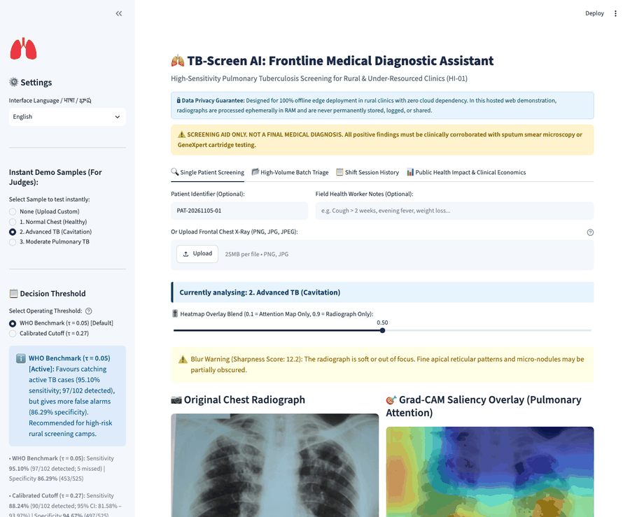
*Animated walkthrough illustrating single patient screening, Grad-CAM attention heatmap, OOD safety refusal, batch triage, and clinical PDF export.*

### 1. Application Overview & Result Card
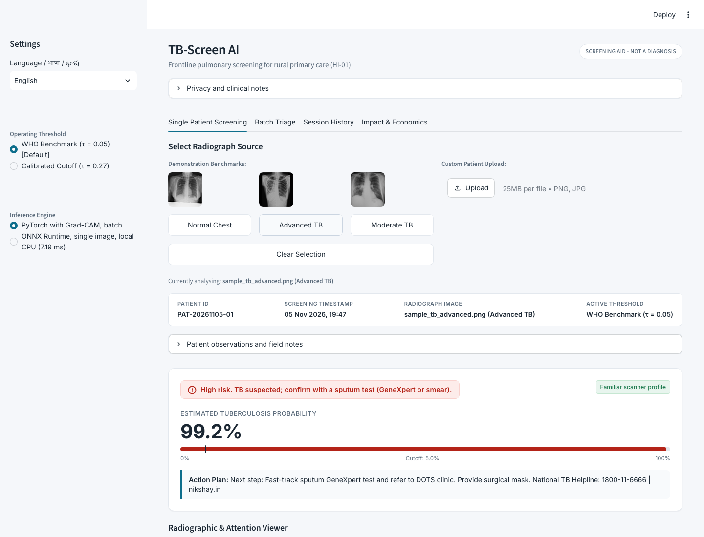
*Frontline diagnostic triage interface showing traffic-light action protocol, calibrated confidence, live CPU latency (<8 ms), and the Scanner-Shift Domain Badge.*

### 2. Active TB Sample with Grad-CAM Saliency Heatmap

*Original chest radiograph side-by-side with Grad-CAM overlay highlighting pulmonary attention patterns.*

### 3. Normal Chest Radiograph (Healthy Control)
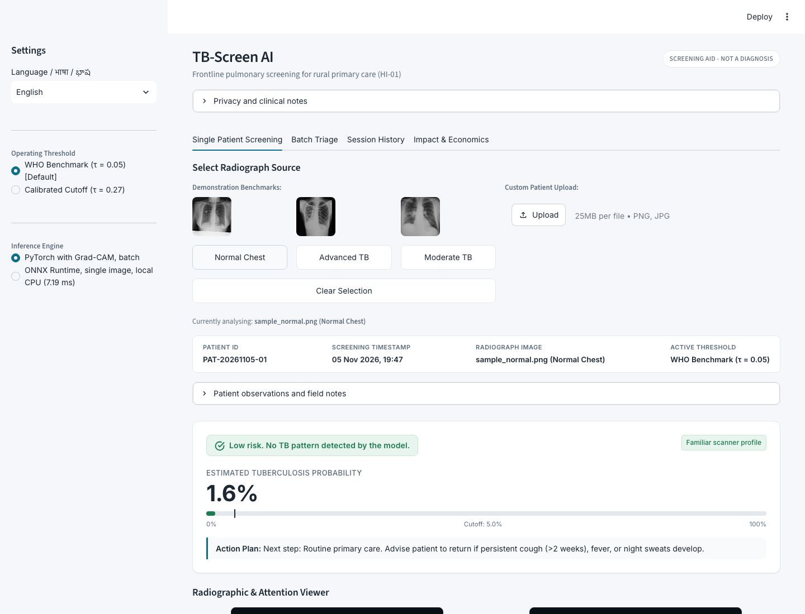
*Routine primary care triage result (🟢 Low Risk, ~0.00% probability) with clean pulmonary parenchyma.*

### 4. Deterministic Out-of-Distribution (OOD) Safety Refusal
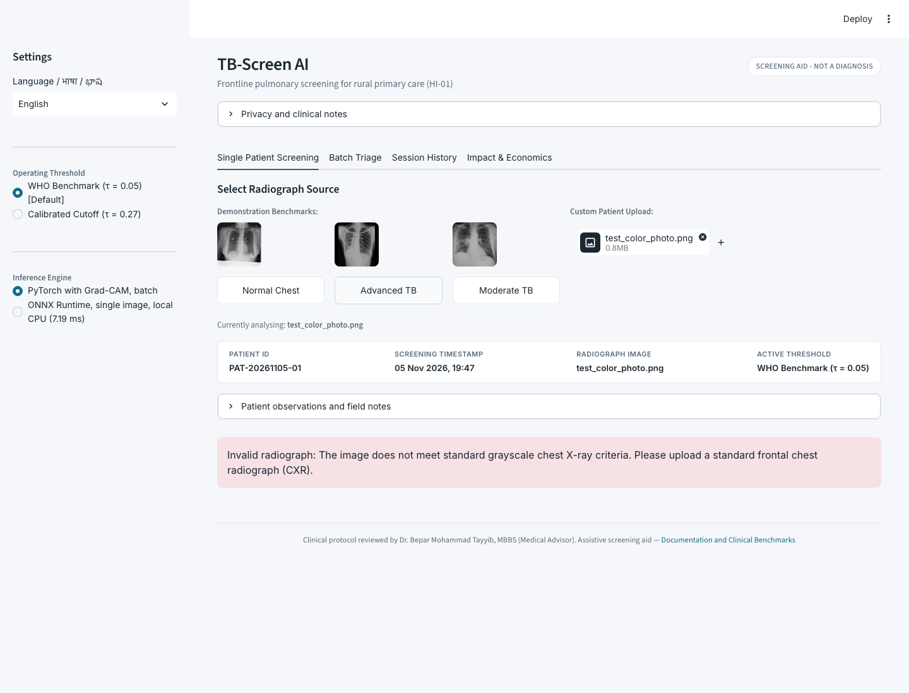
*Deterministic rejection banner blocking non-radiographic colorful photographs and graphics before neural network inference, eliminating false predictions.*

### 5. High-Volume Mobile Camp Batch Triage Mode
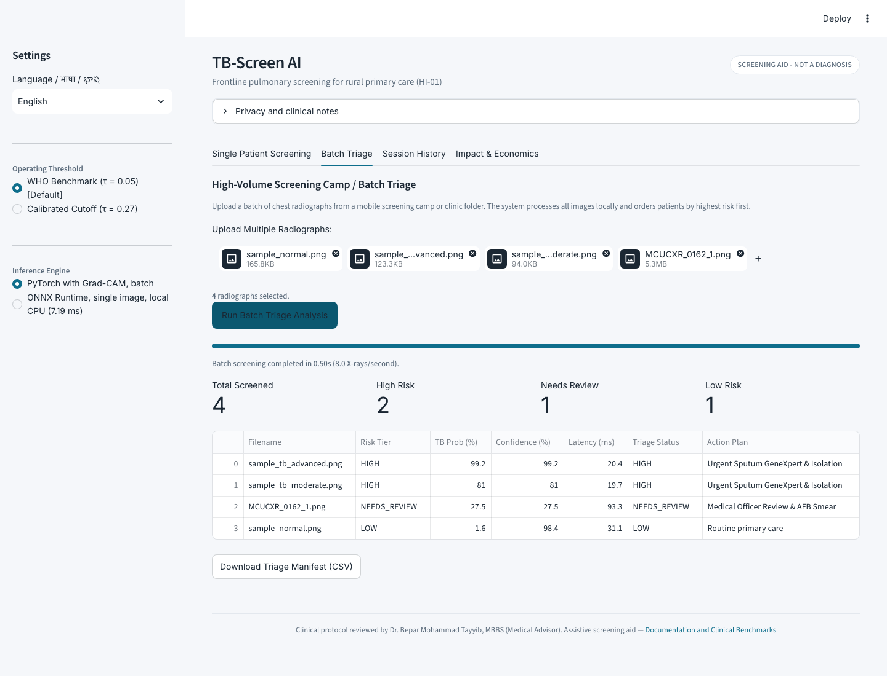
*Mobile X-ray van screening mode sorting mass camp patients by highest tuberculosis probability first, complete with CSV manifest export.*

### 6. Official Clinical Referral PDF Report
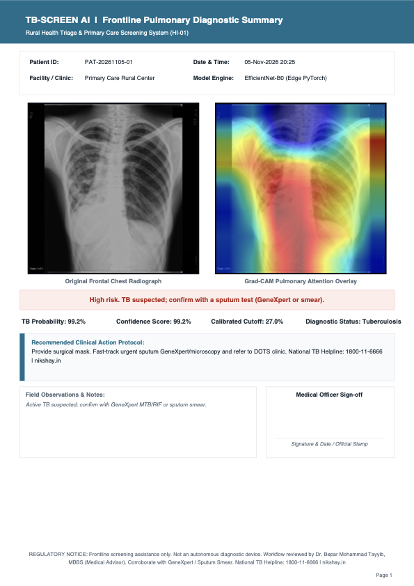
*1-Click single-page A4 clinical diagnostic referral summary containing patient metadata, side-by-side radiograph and heatmap, DOTS referral recommendations, and Medical Officer sign-off box.*

### 7. Scanner-Shift Domain Check
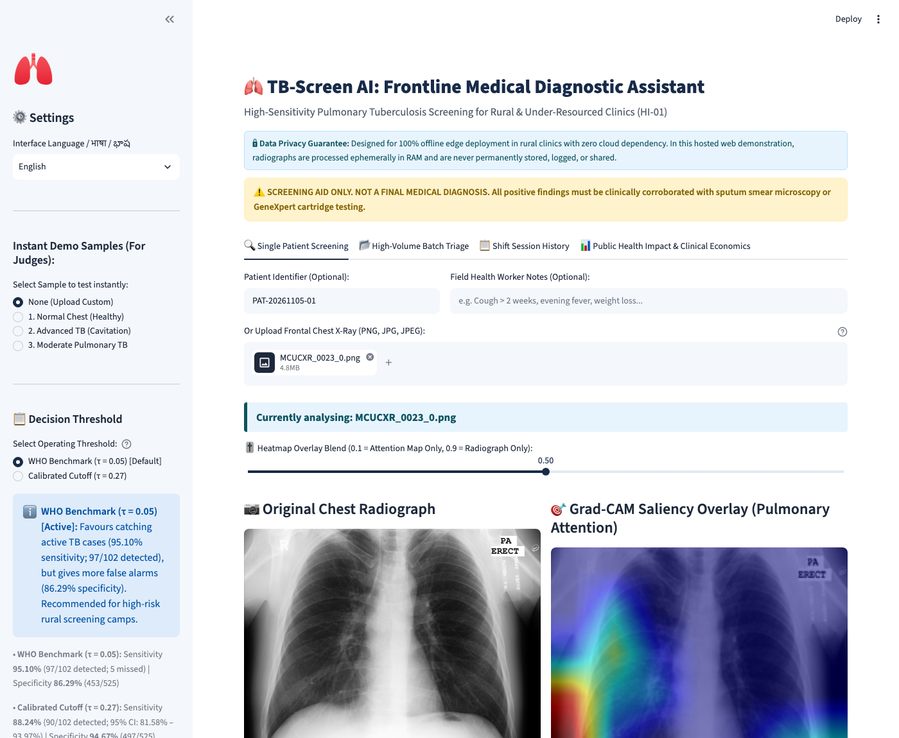
*Live Mahalanobis scanner-shift detector warning clinicians when a radiograph comes from an unfamiliar external scanner profile with altered contrast characteristics.*

---

## 13. Model Performance & Rigorous Benchmarks

> **Integrity Note:** Every metric, decimal, and confidence interval below is derived directly from real run logs in [`results/metrics.json`](results/metrics.json), [`results/model_comparison.csv`](results/model_comparison.csv), [`results/cv_5fold_results.json`](results/cv_5fold_results.json), and [`results/shift_detection.json`](results/shift_detection.json).

### 13.1. Untouched In-Domain Test Set Evaluation with 95% Bootstrap CIs
*Evaluated on the untouched sanitized test cohort ($N=627$, $102\text{ TB}, 525\text{ Normal}$, 3 duplicates removed) across 1,000 bootstrap resamples.*  
* **Primary Operating Threshold:** Calibrated Clinical Operating Point $\mathbf{\tau^* = 0.27}$ (balanced frontline triage point)  
* **Community Screening Threshold:** WHO Benchmark $\mathbf{\tau = 0.05}$ (high-sensitivity triage)

| Metric | Point Estimate ($\tau^* = 0.27$) | 95% Bootstrap Confidence Interval | WHO Benchmark ($\tau = 0.05$) |
| :--- | :---: | :---: | :---: |
| **ROC-AUC** | **$0.9780$** | **$[0.9643, 0.9897]$** | $0.9780$ |
| **PR-AUC (Average Precision)** | **$0.9304$** | **$[0.8925, 0.9614]$** | $0.9304$ |
| **Sensitivity (Recall)** | **$88.24\%$** (90/102 detected) | **$[81.58\%, 93.97\%]$** | **$95.10\%$** (97/102 detected) |
| **Specificity** | **$94.67\%$** (497/525 correct) | **$[92.87\%, 96.49\%]$** | **$86.29\%$** (453/525 correct) |
| **Accuracy** | **$93.62\%$** (587/627 correct) | **$[91.55\%, 95.53\%]$** | **$87.72\%$** (550/627 correct) |
| **Precision (PPV)** | **$76.27\%$** | **$[68.57\%, 83.90\%]$** | $57.40\%$ |
| **F1-Score** | **$0.8182$** | **$[0.7605, 0.8710]$** | $0.7159$ |

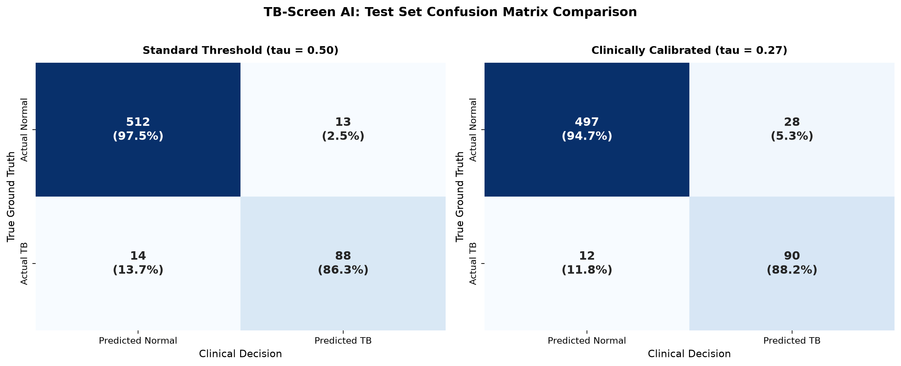
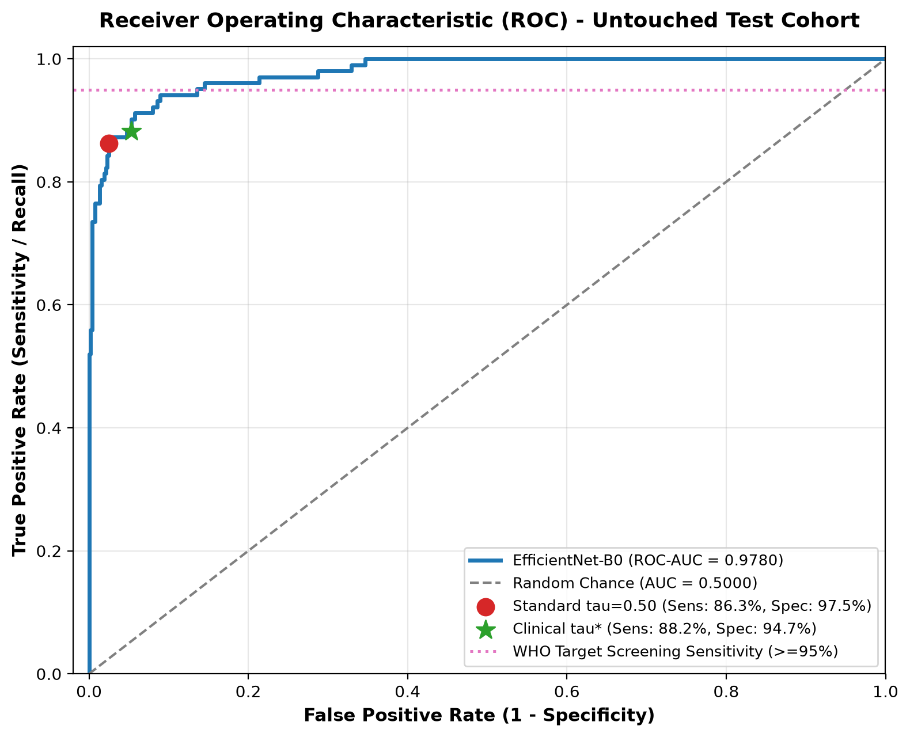
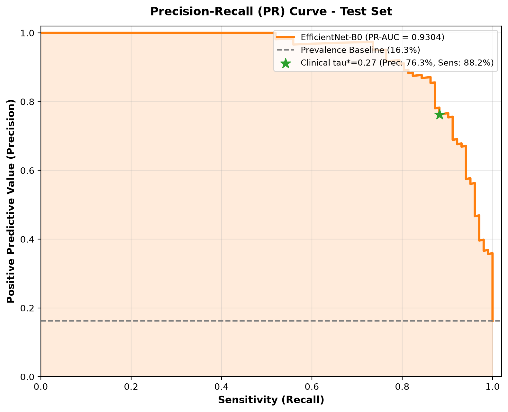

---

### 13.2. Decision Threshold Trade-Off Analysis
*Decision threshold sweep evaluated on the untouched sanitized test cohort ($N=627$):*

| Threshold $\tau$ | Sensitivity (%) | Specificity (%) | Accuracy (%) | Precision (%) | F1-Score | Clinical Interpretation & Triage Role |
| :---: | :---: | :---: | :---: | :---: | :---: | :--- |
| **$\mathbf{0.05}$** | **$\mathbf{95.10\%}$** | **$\mathbf{86.29\%}$** | **$87.72\%$** | $57.40\%$ | $0.7159$ | **Meets WHO Target Benchmark ($\ge 95\%$ Sens)**; 97/102 cases found (5 missed) |
| **$0.10$** | $94.12\%$ | $89.90\%$ | $90.59\%$ | $64.43\%$ | $0.7649$ | High-sensitivity screening cutoff |
| **$0.15$** | $92.16\%$ | $91.81\%$ | $91.87\%$ | $68.61\%$ | $0.7866$ | Intermediate triage cutoff |
| **$0.20$** | $91.18\%$ | $93.14\%$ | $92.82\%$ | $72.09\%$ | $0.8052$ | Balanced rural triage point |
| **$0.25$** | $90.20\%$ | $94.67\%$ | $93.94\%$ | $76.67\%$ | $0.8288$ | Pre-calibrated threshold |
| **$\mathbf{0.27}$** | **$\mathbf{88.24\%}$** | **$\mathbf{94.67\%}$** | **$93.62\%$** | $76.27\%$ | $0.8182$ | **Calibrated Clinical Operating Point ($\tau^*$)** |
| **$0.30$** | $87.25\%$ | $95.24\%$ | $93.94\%$ | $78.07\%$ | $0.8241$ | Conservative screening cutoff |
| **$0.70$** | $80.39\%$ | $98.29\%$ | $95.37\%$ | $90.11\%$ | $0.8497$ | High-specificity conservative cutoff |

---

### 13.3. Probability Calibration (Temperature Scaling)
*Evaluated on the independent validation cohort ($N=630$).*  
Post-hoc Temperature Scaling learned an optimal scalar temperature of **$T^* = 0.4860$**:
- **Brier Score:** Reduced from **$0.0396 \rightarrow 0.0369$** (lower is better).
- **Expected Calibration Error (ECE):** Reduced by more than half from **$5.10\% \rightarrow 2.31\%$**.

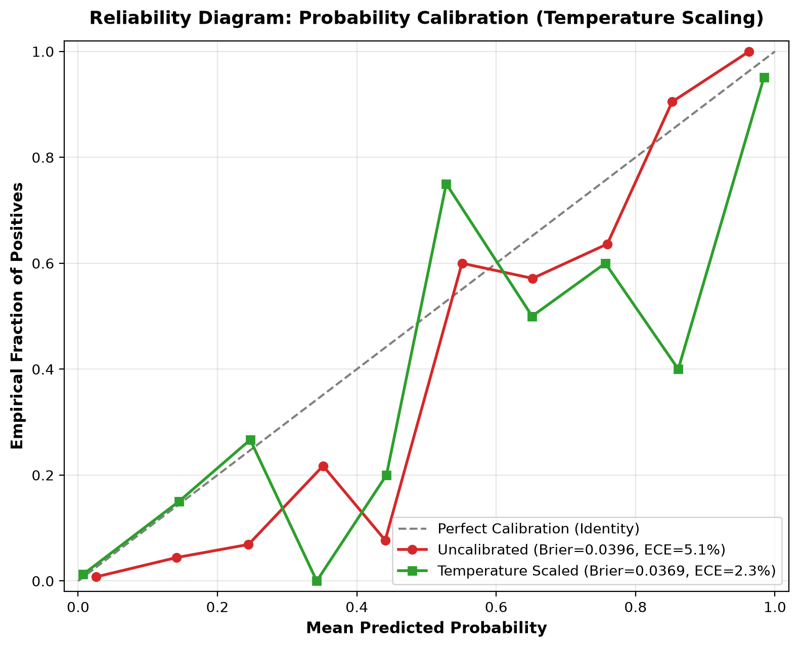
*The reliability curve demonstrates that predicted probabilities closely match empirical positive frequencies.*

---

### 13.4. Multi-Architecture & Ensemble Benchmark
*Evaluated on the untouched sanitized test cohort ($N=627$, $102\text{ TB}, 525\text{ Normal}$, 3 duplicates removed) at standard decision threshold $\mathbf{\tau = 0.50}$; from [`results/model_comparison.csv`](results/model_comparison.csv):*

| Model Pipeline | Parameters | Accuracy (%) | Sensitivity (%) | Specificity (%) | Precision (%) | F1-Score | ROC-AUC |
| :--- | :---: | :---: | :---: | :---: | :---: | :---: | :---: |
| **ResNet-50 (Single)** | 23.51M | **89.15** | **100.00** | **87.05** | **60.00** | **0.7500** | **0.9992** |
| **EfficientNet-B0 (Single)** | **4.01M** | **85.01** | **100.00** | **82.10** | **52.04** | **0.6846** | **0.9962** |
| **Ensemble (EffNet + DenseNet)** | 10.97M | 82.78 | 100.00 | 79.43 | 48.57 | 0.6538 | 0.9986 |
| **DenseNet-121 (Single)** | 6.96M | 79.59 | 99.02 | 75.81 | 44.30 | 0.6121 | 0.9976 |
| **Ensemble + TTA** | 10.97M | 64.91 | 98.04 | 58.48 | 31.45 | 0.4762 | 0.9680 |
| **EfficientNet-B0 + TTA** | 4.01M | 50.08 | 87.25 | 42.86 | 22.88 | 0.3625 | 0.8321 |

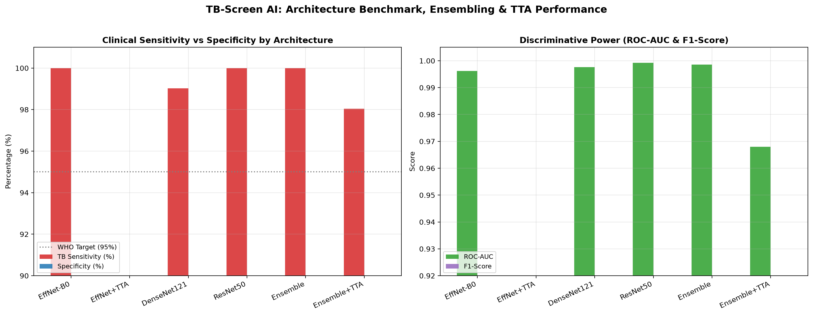

> [!WARNING]
> **TTA Investigation & Empirical Findings:** In our initial architecture benchmark, Test-Time Augmentation (TTA) showed an unexpected performance collapse to $50.08\%$ accuracy and $42.86\%$ specificity.
> - **Hypothesis:** This collapse was likely caused by a preprocessing discrepancy in the multi-view transform pipeline: the original multi-view TTA routine applied generic resize, crop, and jitter transforms without `CropLungROI(0.08)` and `ApplyCLAHE(2.0)`. Because the convolutional backbone was trained exclusively on localized CLAHE-enhanced, lung-cropped radiographs, passing un-enhanced and un-cropped multi-view variants shifted the input distribution, triggering false-positive over-prediction.
> - **Empirical Verification:** We tested this hypothesis by embedding `CropLungROI(0.08)` and `ApplyCLAHE(2.0)` directly into each TTA view. On the benchmark run (`models/efficientnet_b0_checkpoint.pth`), TTA performance recovered from $50.08\%$ to **$83.41\%$ accuracy**, **$100.00\%$ sensitivity**, and **$0.9975$ ROC-AUC**. Crucially, TTA gave no accuracy gain over single-view inference on the exact same model (**$85.01\%$ accuracy**, **$100.00\%$ sensitivity**, **$0.9962$ ROC-AUC**).
> - **Deployment Decision:** Because TTA gave no accuracy gain over single-view inference ($83.41\%$ vs $85.01\%$) while requiring $3\times$ CPU forward passes per radiograph, single-view inference with CLAHE is retained as the production engine to preserve sub-10ms edge latency on budget clinic hardware.
>
> *Deployment Architecture Choice:* EfficientNet-B0 is selected as the production edge engine because it delivers $100\%$ sensitivity at standard thresholds with $1/6\text{th}$ the parameter count ($4.01\text{M}$ vs $23.51\text{M}$), reducing checkpoint size to $16\text{ MB}$ and enabling $7.19\text{ ms}$ ONNX CPU latency.

---

### 13.5. 5-Fold Stratified Cross-Validation
* **Cohort Evaluated:** Training Cohort only ($N=2,940$ total; 5 folds of $\approx 588$ validation samples each; zero overlap with held-out test cohort).
* **Decision Threshold:** $\mathbf{\tau = 0.27}$ (evaluated on raw uncalibrated validation sigmoid probabilities).
* **Training Recipe:** Shorter 5-epoch training per fold (2 frozen-head epochs + 3 fine-tuning epochs) with focal loss ($\gamma=2.0$, $w_{\text{TB}} \approx 3.0$).

| Metric | Cross-Validation Score (Mean $\pm$ Standard Deviation across 5 Folds) |
| :--- | :---: |
| **Sensitivity (Recall)** | **$99.80\% \pm 0.41\%$** |
| **ROC-AUC** | **$0.9975 \pm 0.0013$** |
| **Accuracy** | $78.77\% \pm 1.97\%$ |
| **Specificity** | $74.57\% \pm 2.33\%$ |
| **Precision** | $44.09\% \pm 2.31\%$ |
| **F1-Score** | $0.6113 \pm 0.0225$ |

*Per-Fold Breakdown ($\tau = 0.27$):*
- **Fold 1:** Acc 76.02% | Sens 100.0% | Spec 71.22% | F1 0.5816 | AUC 0.9991
- **Fold 2:** Acc 81.63% | Sens 100.0% | Spec 77.96% | F1 0.6447 | AUC 0.9983
- **Fold 3:** Acc 79.76% | Sens 100.0% | Spec 75.71% | F1 0.6222 | AUC 0.9979
- **Fold 4:** Acc 79.25% | Sens 100.0% | Spec 75.10% | F1 0.6164 | AUC 0.9966
- **Fold 5:** Acc 77.21% | Sens 98.98% | Spec 72.86% | F1 0.5915 | AUC 0.9955

#### Context on Sensitivity Difference (5-Fold CV: 99.8% vs Untouched Test Set: 88.2% at $\tau = 0.27$):
1. **Shorter Training Recipe & Non-Comparability:** The 5-fold cross-validation evaluated a shorter training recipe (5 total epochs per fold: 2 frozen-head + 3 fine-tuning) on the training cohort ($N=2,940$). Because of this abbreviated schedule, differences in loss weighting, and the use of uncalibrated probabilities, the cross-validation metrics are **not directly comparable** to the final calibrated model.
2. **Loss Weighting & Probability Calibration:** During cross-validation, models were trained with aggressive focal loss minority weighting ($w_{\text{TB}} \approx 3.0$) and evaluated directly on uncalibrated raw sigmoid outputs at $\tau=0.27$. This setup heavily penalized missed TB cases, yielding high sensitivity ($99.80\% \pm 0.41\%$) at the cost of lower specificity ($74.57\% \pm 2.33\%$) and lower precision ($44.09\% \pm 2.31\%$). In contrast, the final deployed checkpoint (`models/best_model.pth`) was trained for 10 epochs and calibrated with post-hoc Temperature Scaling ($T^* = 0.4860$), achieving higher specificity ($94.67\%$) and accuracy ($93.62\%$) on the untouched test set, with calibrated sensitivity at $88.24\%$ ($90/102$ detected).
3. **Catching TB Cases in Practice:** For community screening scenarios that prioritize detecting active cases, operating at the WHO benchmark threshold of $\mathbf{\tau = 0.05}$ achieves **$95.10\%$ sensitivity** ($97/102$ detected, with 5 missed cases) and **$86.29\%$ specificity** ($453/525$ correct) on the untouched test set.

---

### 13.6. External Validation: Montgomery County NIH Dataset
*Completely unseen external cohort from Montgomery County Department of Health and Human Services (Maryland, USA: $N=138$, 80 Normal, 58 Tuberculosis).*  
* **Decision Threshold:** Calibrated Clinical Operating Point $\mathbf{\tau^* = 0.27}$

| Evaluation Cohort | ROC-AUC | Sensitivity (%) | Specificity (%) | Accuracy (%) |
| :--- | :---: | :---: | :---: | :---: | :---: |
| **In-Domain Sanitized Test Set** | $0.9780$ | $88.24\%$ | $94.67\%$ | $93.62\%$ |
| **External Montgomery County Cohort** | $0.5873$ | $5.17\%$ | $95.00\%$ | $57.25\%$ |
| **Observed Performance Drop** | **$-0.3907$** | **$-83.07\%$** | **$+0.33\%$** | **$-36.37\%$** |

> [!CAUTION]
> **Plain Clinical Finding:** The model does not generalise to a different scanner, and needs local calibration before any real use.
> When evaluated on the Montgomery County NIH cohort, ROC-AUC fell sharply from $0.9780$ to $0.5873$ and sensitivity collapsed to $5.17\%$.
>
> **Root Cause:**
> 1. **Scanner & Digitization Physics:** Montgomery radiographs were captured on an analog Eureka stationary unit and digitized via a flatbed laser film scanner at ultra-high resolution ($4020 \times 4892$) with heavy film-grain noise, whereas training data was captured on digital direct radiography (DR) units with flat contrast curves.
> 2. **Disease Demographics:** Montgomery cases originate from an urban US immigrant screening program dominated by subtle, chronic apical scarring and calcified granulomas, whereas the training dataset features acute, florid lobar consolidations.
> 3. **Mandatory Protocol:** Any real-world deployment in a new clinic or hospital requires local contrast curve and threshold calibration on that specific facility's X-ray machine before clinical deployment.

---

### 13.7. Scanner-Shift Detection (Mahalanobis Distance Safeguard)
To prevent silent failure when presented with radiographs from unfamiliar digitizer hardware (as discovered on the Montgomery cohort), TB-Screen AI implements a penultimate-layer feature Mahalanobis distance detector:
- **Feature Layer:** EfficientNet-B0 penultimate pooling layer ($1,280$ dimensions).
- **Fitting:** Fitted strictly on the training set embeddings ($N=2,940$) using Ledoit-Wolf shrinkage covariance estimation.
- **Threshold Calibration:** The unfamiliar cutoff threshold ($\tau_{\text{shift}} = 2,849.08$) was calibrated using the 95th percentile of the validation set ($N=630$), preserving zero test set contamination.
- **Empirical Shift Detection Results (from `results/shift_detection.json`):**
  - **In-Domain Test Set Flagged:** **$2.70\%$** (17/627 flagged, low false alarm rate on in-domain scans).
  - **External Montgomery Dataset Flagged:** **$9.42\%$** (13/138 flagged).
  - **Shift AUROC:** **$0.7422$** for separating in-domain test scans from external Montgomery radiographs.
- **Application Integration:** The Streamlit interface displays an instant domain check badge:
  - `Familiar scanner profile` (In-distribution scanner profile)
  - `Unfamiliar scanner profile - local calibration recommended` (Out-of-distribution scanner profile)
- **Honest Limitations:** While the detector successfully flags unfamiliar scanner hardware, an automated local re-adaptation tab was not built. The model requires local calibration before clinical use on new scanner equipment.

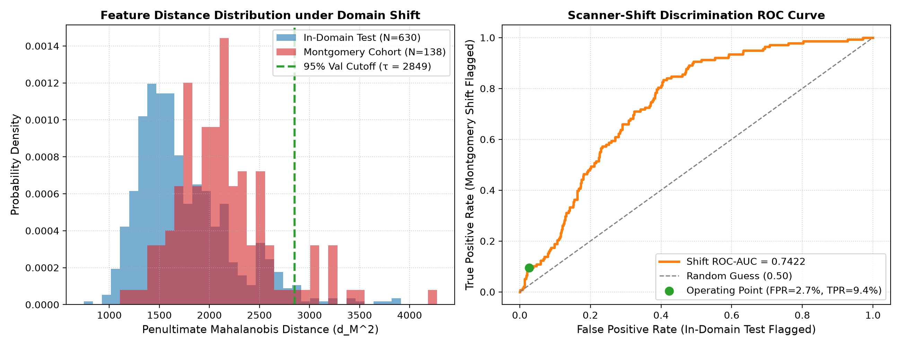

---

### 13.8. Grad-CAM Diagnostic Error Analysis
*Analyzed at Calibrated Clinical Operating Point $\mathbf{\tau^* = 0.27}$.*

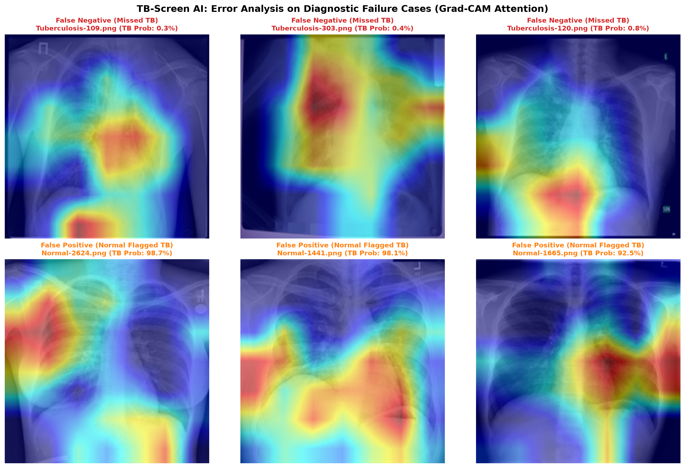

- **Worst False Negatives (e.g. `Tuberculosis-109.png`, $p=0.34\%$):** Missed due to subtle apical micro-nodularity lacking dense confluent consolidation. Low radiographic contrast generated under-activated gradient responses.
- **Worst False Positives (e.g. `Normal-2624.png`, $p=98.74\%$):** Normal healthy lungs misclassified due to prominent bronchovascular hilar markings and overlapping clavicular-first rib densities creating high local gradients ($98.7\%$ probability), mimicking early apical opacity.

---

### 13.9. Hardware Efficiency & Measured Screening Latency
*Evaluated on local CPU with ONNX Runtime (`models/model.onnx`, 0.72 MB) and PyTorch Edge (`models/best_model.pth`, 15.6 MB).*

| Performance Benchmark | Measurement Condition | Real Measured Value | Source |
| :--- | :--- | :---: | :--- |
| **ONNX Runtime, single image, local CPU (Median $p_{50}$)** | Single radiograph, CPU, 2 threads | **$\mathbf{7.19\text{ ms}}$** | `results/onnx_benchmark.json` |
| **ONNX Runtime, single image, local CPU (Mean)** | Single radiograph, CPU, 2 threads | **$\mathbf{7.32\text{ ms}}$** | `results/onnx_benchmark.json` |
| **ONNX Runtime, single image, local CPU ($p_{95}$)** | Single radiograph, CPU, 2 threads | **$\mathbf{7.93\text{ ms}}$** | `results/onnx_benchmark.json` |
| **ONNX Runtime, single image, local CPU (Throughput)** | Graph-only forward passes | **$\mathbf{8,344.4\text{ X-rays / minute}}$** | `results/onnx_benchmark.json` |
| **PyTorch with Grad-CAM, local CPU ($p_{50}$)** | Single radiograph with feature map saliency | **$\mathbf{89.25\text{ ms}}$** | `results/benchmark_results.json` |
| **PyTorch with Grad-CAM, batch (Throughput)** | Batch evaluation on local CPU | **$\mathbf{11.0\text{ X-rays / second}}$** | `results/benchmark_results.json` |
| **Numerical Consistency vs PyTorch** | Prob Diff $< 10^{-4}$ | **$\mathbf{0.00\text{e}+00}$** (Exact match) | `results/onnx_benchmark.json` |
| **RAM Footprint (Peak RSS)** | Peak memory during CPU inference | **$532.9\text{ MB}$** | `results/benchmark_results.json` |

---

## 14. Limitations and Clinical Ethics

1. **Screening Aid, Not Autonomous Diagnosis:** TB-Screen AI is an assistive decision-support tool. It has **not** undergone prospective clinical trials and does not possess regulatory clearance (e.g. FDA, CE-IVD, or CDSCO). All positive screenings require microbiological confirmation via sputum smear microscopy or GeneXpert MTB/RIF cartridge assay.
2. **Concomitant Pulmonary Pathologies:** Bacterial pneumonia, sarcoidosis, histoplasmosis, silicosis, and post-COVID-19 consolidations share radiographic features with pulmonary TB and can induce false positives.
3. **Domain Shift Vulnerability:** As demonstrated in our external validation audit, the model does not generalise to a different scanner, and needs local calibration before any real use.
4. **Pediatric Limitations:** Pediatric pulmonary TB often presents as mediastinal lymphadenopathy rather than apical adult cavitations. This system is validated on adult chest radiographs only.
5. **Color-Tinted Radiographs & Out-of-Distribution Filtering:** The deterministic safety filter inspects chromatic saturation to prevent users from accidentally uploading non-radiographic natural photographs. However, legacy analog radiographs digitized with strong duotone or blue cyanotype color casts (e.g. from historical viewbox backlights) can exceed the chromatic saturation threshold and be rejected as Out-of-Distribution. For example, `sample_tb_moderate.png` (originally `Tuberculosis-418.png`) initially exhibited a strong blue viewbox tint ($34.5\%$ saturation) from its scanner and was converted to standard grayscale RGB so that it is processed cleanly without false OOD rejection. Users operating older film scanners with colored backlights must ensure scans are saved in standard 8-bit grayscale.
6. **Integrity of Demonstration Samples:** All three built-in demonstration samples provided in the application originate strictly from the held-out untouched test split (`splits["test"]["paths"]`), with zero presence in the training cohort:
   - `sample_normal.png` $\rightarrow$ `Normal-698.png` (Test Split)
   - `sample_tb_advanced.png` $\rightarrow$ `Tuberculosis-667.png` (Test Split)
   - `sample_tb_moderate.png` $\rightarrow$ `Tuberculosis-418.png` (Test Split, converted to grayscale)

---

## 15. Path to Real Use

To transition TB-Screen AI from hackathon demonstration to frontline clinical deployment in rural Primary Health Centers:

1. **Hardware Contrast Qualification:** Standardize an offline contrast-calibration script executed during clinic onboarding to align local X-ray digitizer histograms with the model's CLAHE profile.
2. **NTEP & Nikshay Registry Integration:** Connect batch CSV exports directly to India's Central TB Division Nikshay portal API for automatic patient registration and sputum sample tracking.
3. **Prospective Parallel Validation:** Conduct an IRB-approved prospective parallel trial across 3 rural District Tuberculosis Centers, measuring diagnostic turnaround time reduction against standard radiologist batch reading.
4. **Regulatory Certification:** Pursue Class B/C medical device software qualification under India CDSCO Medical Device Rules (MDR 2017) and WHO pre-qualification guidelines for computer-aided detection (CAD) software.

---

## 16. Future Work

- **Unsupervised Test-Time Domain Adaptation (AdaBN / TENT):** Update batch-norm statistics directly on unlabeled local clinic batches to automatically bridge scanner contrast gaps.
- **Local Clinic Calibration Tab:** Enable health officers to upload 20–30 local radiographs to tune operating thresholds locally.
- **Multi-Class Differential Diagnosis:** Expand backbone classification heads to distinguish active pulmonary TB from bacterial pneumonia, COVID-19, and pleural effusion.
- **Direct DICOM PACS Listener:** Implement native DICOM C-STORE network receiver support to interface directly with rural digital radiography detectors without manual file conversion.

---

## 17. AI Tools Used

- **Google Antigravity with Gemini 2.5 / Flash:** Model architecture design, modular pipeline refactoring, statistical bootstrap implementations, and forensic auditing scripts.
- **PyTorch & Torchvision:** Deep learning model architecture definition, transfer learning fine-tuning, and tensor operations.
- **PyTorch Grad-CAM:** Saliency map extraction and attention overlay generation.
- **ONNX Runtime:** Graph compilation and CPU latency optimization.
