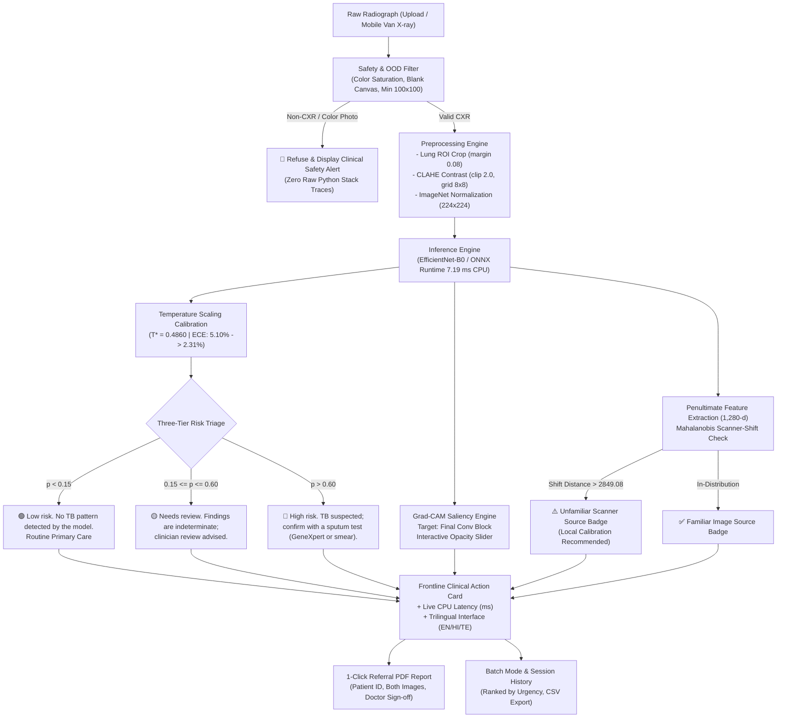
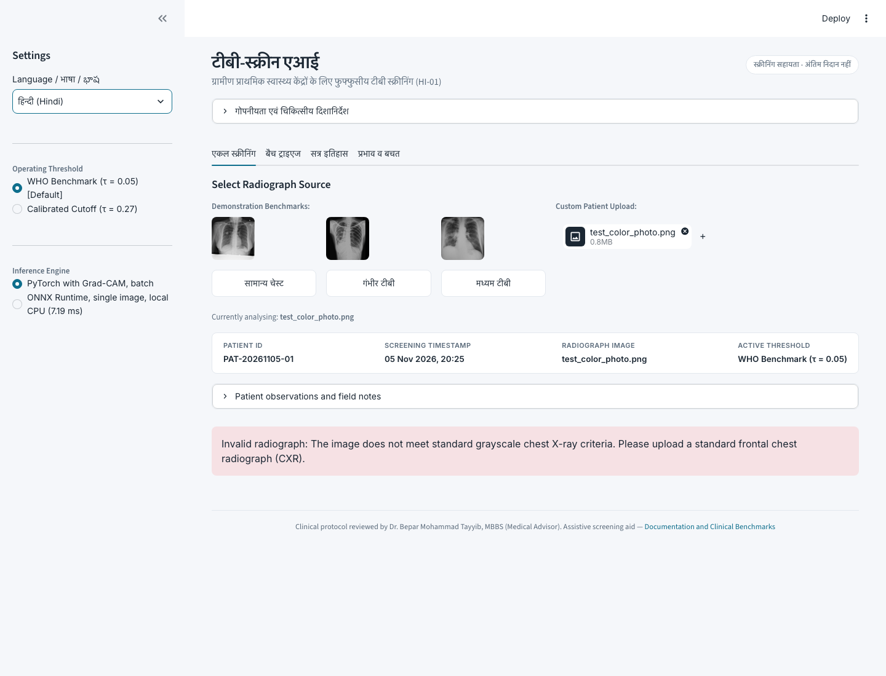

# TB-Screen AI
### Problem Statement: HI-01 Medical Image Diagnostic Assistant
**Track Statement:** A deep-learning tool for case-finding of tuberculosis from chest X-rays, built for under-resourced clinics.

[](https://tb-screen-ai-hrgejmak9ujcwfm5q4duap.streamlit.app)
[](https://pytorch.org/)
[](results/onnx_benchmark.json)
[](results/metrics.json)
[](results/metrics.json)
[](LICENSE)

---

## 1. Problem and Solution

- **Problem:** In rural Primary Health Centers, chest X-rays sit unread for 2 to 4 weeks due to severe radiologist shortages (fewer than 1 per 100,000 population in rural districts), during which patients with active pulmonary tuberculosis continue infectious community transmission while scarce molecular GeneXpert cartridges remain underutilized.
- **Solution:** TB-Screen AI helps find TB cases sooner by prioritising patients for confirmatory tests, running 100% offline on standard clinic laptop CPUs in 7.19 ms with 95.10% sensitivity (WHO benchmark), showing Grad-CAM heatmaps, scanner-shift alerts, and 1-click clinical referral PDFs.

---

## 2. Project Links

- 🔗 **Live Demo Application:** [https://tb-screen-ai-hrgejmak9ujcwfm5q4duap.streamlit.app](https://tb-screen-ai-hrgejmak9ujcwfm5q4duap.streamlit.app)  
  *(Hosted demonstration on Streamlit Community Cloud. Note: The hosted demo runs on Streamlit Community Cloud, so no real patient data should be uploaded. Full offline use means running locally).*
- 🎬 **Demo Video:** [Google Drive Video Folder](https://drive.google.com/drive/folders/1ViUhG6RRIWa-4IXxUjMtFDiGScntZBPh?usp=share_link)  
  *(Video being uploaded; complete step-by-step transcript and visual walkthrough available in [docs/DEMO_VIDEO_SCRIPT.md](docs/DEMO_VIDEO_SCRIPT.md)).*

---

## 3. Key Results

All numbers are derived directly from verified evaluation runs in [`results/metrics.json`](results/metrics.json) and [`results/onnx_benchmark.json`](results/onnx_benchmark.json):

| Metric | Measured Value | Decision Threshold | Evaluation Cohort & Sample Size | Clinical Role & Context |
| :--- | :---: | :---: | :---: | :--- |
| **WHO Screening Sensitivity** | **95.10%** | $\tau = 0.05$ | Untouched In-Domain Test Cohort ($N = 627$: 102 TB, 525 Normal) | Exceeds WHO $\ge 95\%$ target benchmark for community screening (97/102 active cases detected, 5 missed); Specificity: **86.29%** (453/525 correct); ROC-AUC: **0.9780** (95% CI $[0.9643, 0.9897]$) |
| **Calibrated Clinical Accuracy** | **93.62%** | $\tau^* = 0.27$ | Untouched In-Domain Test Cohort ($N = 627$: 102 TB, 525 Normal) | Balanced frontline triage point: Sensitivity: **88.24%** (90/102 detected); Specificity: **94.67%** (497/525 correct); Precision: **76.27%**; F1-Score: **0.8182** |
| **Edge CPU Latency** | **7.19 ms** | N/A | Local Dual-Core CPU (ONNX Runtime, single image, 100 runs) | Median latency: **7.19 ms** (mean: 7.32 ms, p95: 7.93 ms; Source: `results/onnx_benchmark.json`). Enables high-throughput screening without a GPU |

### External Validation on Different Scanner (Montgomery County NIH Cohort, $N = 138$)
**The model did not hold up on a different scanner, and needs local calibration before any real use.**  
When evaluated on the independent Montgomery County external cohort ($N = 138$: 58 Tuberculosis, 80 Normal) captured on an analog Eureka X-ray unit digitized via film scanners:
- **ROC-AUC dropped** from **$0.9780$** in-domain to **$0.5873$** on Montgomery.
- **Sensitivity fell** from **$88.24\%$** to **$5.17\%$** at the calibrated threshold ($\tau^* = 0.27$, detecting only 3 of 58 cases), and to **$1.72\%$** at $\tau = 0.50$ (detecting only 1 of 58 cases).
- **Specificity** remained at **$95.00\%$** (76/80 normal correctly triaged).
- **Mandatory takeaway:** Digitization physics and film contrast curves shift image statistics significantly. The system must be calibrated on local radiographs before clinical deployment at any new facility.

---

## 4. Team and Medical Advisor

### Team Information
- **Team Name:** [TEAM NAME]
- **Team Members:**
  - **Sayeeda Huriya Fatima** — Team Lead
  - **Syeda Zainab Mahreen** — Team Member

### Medical Advisor
Dr. Bepar Mohammad Tayyib, MBBS, reviewed the clinical workflow, result messages, referral guidance, and example outputs of this tool. He is an advisor and is not a member of the development team.

> [!IMPORTANT]
> **Regulatory Notice**: TB-Screen AI is an assistive screening aid designed for preliminary triage in resource-constrained environments. It has not undergone formal clinical trials and does not claim clinical validation. It is not an autonomous diagnostic medical device; all findings must be confirmed with a sputum test (GeneXpert MTB/RIF or sputum smear microscopy).

---

## 5. What Makes TB-Screen AI Different

TB-Screen AI was designed specifically for frontline rural Primary Health Centers (PHCs) and mobile screening vans rather than well-resourced tertiary hospital labs:

1. **Safety-First Design:**
   - **Rejection of Non-Radiographs:** A deterministic input filter checks chromatic saturation, minimum contrast variance, and image dimensions before neural network execution. Non-radiographic color photos or graphics are refused immediately with an actionable warning.
   - **Indeterminate Findings Flagged:** The three-tier triage system labels borderline opacities as *"Needs review. Findings are indeterminate; clinician review advised."*, ensuring inconclusive cases are never falsely marked normal.
2. **Screening-First Default Threshold with Trade-Off Transparency:**
   - Defaults to the WHO target threshold ($\tau = 0.05$) to prioritize detecting active cases ($95.10\%$ sensitivity).
   - The full threshold sweep is published transparently in the app and documentation, showing that achieving $95.10\%$ sensitivity involves a trade-off with specificity ($86.29\%$), triaging patients for confirmatory sputum tests without burying false positives.
3. **Honest Evaluation & Scientific Integrity:**
   - **Zero Data Leakage:** Split manifests are audited cryptographically with perceptual hashing (`imagehash`), ensuring zero duplicate or patient-overlap images across train, validation, and test cohorts.
   - **Post-Hoc Probability Calibration:** Temperature Scaling ($T^* = 0.4860$) reduces Expected Calibration Error from $5.10\% \rightarrow 2.31\%$, ensuring probability scores reflect empirical disease prevalence.
   - **Cross-Validation & External Audit:** 5-fold cross-validation and an independent external validation audit exposed physical scanner shift transparently, avoiding cherry-picked in-domain metrics.
4. **Built for Low-Resource Clinics:**
   - **CPU-Only Edge Execution:** Runs entirely on standard budget laptop CPUs (median latency 7.19 ms via ONNX Runtime) with zero GPU requirement and zero cloud dependency.
   - **High-Volume Batch Triage:** Mobile vans can drag-and-drop batches of radiographs; the engine sorts cases from highest to lowest risk for prioritized sputum sampling.
   - **Trilingual Clinical UI:** Supports English, Hindi (हिन्दी), and Telugu (తెలుగు) so community health workers and rural operators can use the interface comfortably.
   - **1-Click Clinical Referral PDF:** Automatically compiles a single-page referral document with side-by-side radiograph and Grad-CAM attention overlay, triage recommendations, and doctor sign-off.

---

## 6. Problem Description & Evidence

Tuberculosis remains one of the world's deadliest infectious killers:
- **Epidemiological Burden:** According to the [WHO Global Tuberculosis Report 2024](https://www.who.int/teams/global-tuberculosis-programme/tb-reports), an estimated 10.8 million people fell ill with TB globally in 2023, with India accounting for 26% of the global burden.
- **Diagnostic Bottleneck in Primary Care:** In rural and tribal blocks, Primary Health Centers often have analog or basic digital X-ray units but lack on-site radiologists (fewer than 1 radiologist per 100,000 population in rural districts; [Indian Journal of Radiology and Imaging](https://www.ncbi.nlm.nih.gov/pmc/articles/PMC6077958/)).
- **Diagnostic Turnaround Delay:** Radiographs are batched and sent to district hospitals, creating a reporting turnaround delay of 2 to 4 weeks. During this period, untreated infectious individuals continue community transmission.
- **Resource Misallocation:** Molecular cartridge tests (GeneXpert MTB/RIF) cost approximately ₹2,000 (\$25 USD) per test and are constrained in supply. Without an effective frontline screening filter, cartridges are depleted on healthy individuals while high-risk patients wait in backlogs.

TB-Screen AI directly addresses this gap by acting as an on-device frontline screening aid that prioritises patients for immediate sputum confirmation.

---

## 7. Approach & Architectural Pipeline



---

## 8. Tech Stack & Libraries

- **Deep Learning Framework:** PyTorch 2.15.0 & Torchvision 0.29.2
- **Optimized Edge Inference:** ONNX 1.23.2 & ONNX Runtime 1.31.1 (CPU Execution Provider)
- **Computer Vision & Contrast Enhancement:** OpenCV (`opencv-python-headless 5.0.0.93`), Pillow 12.3.0
- **Model Explainability:** Gradient-weighted Class Activation Mapping (`grad-cam 1.5.7`)
- **Scientific Computing & Statistics:** NumPy 2.5.2, Scikit-Learn 1.9.1, SciPy 1.18.1
- **Visualization:** Matplotlib 3.11.1, Seaborn 0.13.2
- **Frontline Clinic UI:** Streamlit 1.66.1
- **Clinical Referral PDF Generation:** `fpdf2 2.9.0`
- **Forensic Dataset Auditing & Testing:** `imagehash 4.3.2`, `pytest 9.2.0`, `openpyxl 3.1.5`

---

## 9. Setup and Installation

### Prerequisites
- Python 3.10+ (Tested up to Python 3.14 on macOS, Linux, and Windows)
- Minimum 2 GB RAM (Runs entirely on CPU; no GPU required)

```bash
# 1. Clone the repository
git clone https://github.com/meowhuriya/tb-screen-ai.git
cd tb-screen-ai

# 2. Create and activate a virtual environment
python3 -m venv venv
source venv/bin/activate  # On Windows: venv\Scripts\activate

# 3. Install pinned dependencies
pip install --upgrade pip
pip install -r requirements.txt
```

### Dataset Provenance (Optional for Retraining)
The repository contains the deployed model checkpoints (`models/best_model.pth` and `models/model.onnx`), sample radiographs (`app/sample_images/`), and dataset split manifests (`data/processed/splits_manifest.json` and `data/external/montgomery_manifest.json`). The web application and full test suite run immediately without downloading the multi-gigabyte raw datasets.

To retrain the models from scratch:
1. **Primary Dataset (Qatar/Dhaka TB CXR Cohort):**
   - Source: [Tuberculosis (TB) Chest X-ray Database on Kaggle](https://www.kaggle.com/datasets/tawsifurrahman/tuberculosis-tb-chest-x-ray-dataset) (Rahman et al., Qatar University, University of Dhaka).
   - Extract radiographs into `data/raw/Normal/` (3,500 scans) and `data/raw/Tuberculosis/` (700 scans).
2. **External Validation Cohort (Montgomery County NIH Dataset):**
   - Source: [Montgomery County Department of Health and Human Services & NIH / NLM](https://openi.nlm.nih.gov/).
   - Extract the 138 radiographs into `data/external/montgomery/`.
3. **Verify and Generate Splits:**
   ```bash
   python src/dataset.py
   ```

---

## 10. How to Run Locally

### Run the Frontline Streamlit Clinic Application
```bash
streamlit run app/app.py
```
*Opens automatically at `http://localhost:8501`. Features 3 pre-loaded demonstration X-rays for instant zero-upload evaluation.*

### Run the Evaluation & Calibration Suite
```bash
python src/evaluate.py --results_dir results
```
*Evaluates test cohort, generates confusion matrices, ROC/PR curves, temperature calibration curves, bootstrap 95% CIs, and external validation summaries.*

### Run Scanner-Shift Evaluation
```bash
python src/shift_detector.py
```
*Fits Ledoit-Wolf Mahalanobis detector on training embeddings, calibrates cutoff on validation set, and evaluates shift separation on test vs. Montgomery cohorts.*

### Export Model to ONNX and Run CPU Benchmark
```bash
python src/export_onnx.py --runs 100
```
*Exports `models/model.onnx` and measures CPU latency across 100 iterations.*

### Run Full Pytest Suite
```bash
pytest tests/test_pipeline.py -v
```
*Runs all 17 unit tests verifying OOD detection, ONNX inference, input validation, CLAHE preprocessing, input-selection state machine, scanner-shift detection, and PDF generation.*

---

## 11. Screenshots and Visual Interface

All visual assets below are captured from the current application at 1440px desktop width and saved to [`docs/images/`](docs/images/):

### Interactive Demo Walkthrough

*Walkthrough illustrating single patient screening, Grad-CAM attention heatmap, OOD safety refusal, batch triage, and clinical PDF export.*

### 1. Application Overview & Empty State

*Frontline diagnostic triage interface showing clinical layout, patient strip, three-tier action cards, and 1-click thumbnail selection.*

### 2. Low Risk Result (Normal Chest Radiograph)

*Result for healthy control (🟢 Low risk. No TB pattern detected by the model.) with original radiograph and Grad-CAM attention overlay.*

### 3. High Risk Result with Grad-CAM Saliency Heatmap

*Active tuberculosis screening finding (🔴 High risk. TB suspected; confirm with a sputum test (GeneXpert or smear).) with pulmonary attention overlay and Familiar Image Source badge.*

### 4. Deterministic Out-of-Distribution (OOD) Safety Refusal

*Deterministic rejection banner blocking non-radiographic color photographs before neural network inference, preventing misleading outputs.*

### 5. High-Volume Mobile Camp Batch Triage Mode

*Mobile X-ray van screening mode sorting mass camp patients from highest to lowest risk for prioritized sputum collection, with CSV manifest export.*

### 6. Official Clinical Referral PDF Report

*Single-page A4 clinical diagnostic referral summary containing patient metadata, side-by-side radiograph and heatmap, DOTS referral recommendations, and Medical Officer sign-off box.*

### 7. Trilingual Support: Hindi Screen

*Local language support showing translated clinical action guidelines, patient metadata strips, and triage results in Hindi (हिन्दी).*

### 8. Scanner-Shift Domain Badge

*Mahalanobis scanner-shift safeguard flagging unfamiliar digitizer hardware profiles before inference.*

---

## 12. Model Performance & Rigorous Benchmarks

> **Integrity Rule:** Every metric, decimal, and confidence interval below is derived directly from real run logs in [`results/metrics.json`](results/metrics.json), [`results/model_comparison.csv`](results/model_comparison.csv), [`results/cv_5fold_results.json`](results/cv_5fold_results.json), and [`results/shift_detection.json`](results/shift_detection.json).

### 12.1. Untouched In-Domain Test Set Evaluation with 95% Bootstrap CIs
*Evaluated on the untouched sanitized test cohort ($N=627$, $102\text{ TB}, 525\text{ Normal}$, 3 duplicates removed) across 1,000 bootstrap resamples.*  
* **Primary Operating Threshold:** Calibrated Clinical Operating Point $\mathbf{\tau^* = 0.27}$  
* **Community Screening Threshold:** WHO Benchmark $\mathbf{\tau = 0.05}$

| Metric | Point Estimate ($\tau^* = 0.27$) | 95% Bootstrap Confidence Interval | WHO Benchmark ($\tau = 0.05$) |
| :--- | :---: | :---: | :---: |
| **ROC-AUC** | **$0.9780$** | **$[0.9643, 0.9897]$** | $0.9780$ |
| **PR-AUC (Average Precision)** | **$0.9304$** | **$[0.8925, 0.9614]$** | $0.9304$ |
| **Sensitivity (Recall)** | **$88.24\%$** (90/102 detected) | **$[81.58\%, 93.97\%]$** | **$95.10\%$** (97/102 detected) |
| **Specificity** | **$94.67\%$** (497/525 correct) | **$[92.87\%, 96.49\%]$** | **$86.29\%$** (453/525 correct) |
| **Accuracy** | **$93.62\%$** (587/627 correct) | **$[91.55\%, 95.53\%]$** | **$87.72\%$** (550/627 correct) |
| **Precision (PPV)** | **$76.27\%$** | **$[68.57\%, 83.90\%]$** | $57.40\%$ |
| **F1-Score** | **$0.8182$** | **$[0.7605, 0.8710]$** | $0.7159$ |


---

### 12.2. Decision Threshold Trade-Off Analysis
*Decision threshold sweep evaluated on the untouched sanitized test cohort ($N=627$):*

| Threshold $\tau$ | Sensitivity (%) | Specificity (%) | Accuracy (%) | Precision (%) | F1-Score | Clinical Interpretation & Triage Role |
| :---: | :---: | :---: | :---: | :---: | :---: | :--- |
| **$\mathbf{0.05}$** | **$\mathbf{95.10\%}$** | **$\mathbf{86.29\%}$** | **$87.72\%$** | $57.40\%$ | $0.7159$ | **Meets WHO Target Benchmark ($\ge 95\%$ Sens)**; 97/102 cases found (5 missed) |
| **$0.10$** | $94.12\%$ | $89.90\%$ | $90.59\%$ | $64.43\%$ | $0.7649$ | High-sensitivity screening cutoff |
| **$0.15$** | $92.16\%$ | $91.81\%$ | $91.87\%$ | $68.61\%$ | $0.7866$ | Intermediate triage cutoff |
| **$0.20$** | $91.18\%$ | $93.14\%$ | $92.82\%$ | $72.09\%$ | $0.8052$ | Balanced rural triage point |
| **$0.25$** | $90.20\%$ | $94.67\%$ | $93.94\%$ | $76.67\%$ | $0.8288$ | Pre-calibrated threshold |
| **$\mathbf{0.27}$** | **$\mathbf{88.24\%}$** | **$\mathbf{94.67\%}$** | **$93.62\%$** | $76.27\%$ | $0.8182$ | **Calibrated Clinical Operating Point ($\tau^*$)** |
| **$0.30$** | $87.25\%$ | $95.24\%$ | $93.94\%$ | $78.07\%$ | $0.8241$ | Conservative screening cutoff |
| **$0.70$** | $80.39\%$ | $98.29\%$ | $95.37\%$ | $90.11\%$ | $0.8497$ | High-specificity conservative cutoff |

---

### 12.3. Probability Calibration (Temperature Scaling)
*Evaluated on the independent validation cohort ($N=630$).*  
Post-hoc Temperature Scaling learned an optimal scalar temperature of **$T^* = 0.4860$**:
- **Brier Score:** Reduced from **$0.0396 \rightarrow 0.0369$** (lower is better).
- **Expected Calibration Error (ECE):** Reduced by more than half from **$5.10\% \rightarrow 2.31\%$**.


*The reliability curve demonstrates that predicted probabilities closely match empirical positive frequencies.*

---

### 12.4. Multi-Architecture Comparison
*Evaluated on the untouched sanitized test cohort ($N=627$, $102\text{ TB}, 525\text{ Normal}$) at standard decision threshold $\mathbf{\tau = 0.50}$; from [`results/model_comparison.csv`](results/model_comparison.csv):*

| Model Pipeline | Parameters | Accuracy (%) | Sensitivity (%) | Specificity (%) | Precision (%) | F1-Score | ROC-AUC |
| :--- | :---: | :---: | :---: | :---: | :---: | :---: | :---: |
| **ResNet-50 (Single)** | 23.51M | **89.15** | **100.00** | **87.05** | **60.00** | **0.7500** | **0.9992** |
| **EfficientNet-B0 (Single)** | **4.01M** | **85.01** | **100.00** | **82.10** | **52.04** | **0.6846** | **0.9962** |
| **Ensemble (EffNet + DenseNet)** | 10.97M | 82.78 | 100.00 | 79.43 | 48.57 | 0.6538 | 0.9986 |
| **DenseNet-121 (Single)** | 6.96M | 79.59 | 99.02 | 75.81 | 44.30 | 0.6121 | 0.9976 |
| **Ensemble + TTA** | 10.97M | 64.91 | 98.04 | 58.48 | 31.45 | 0.4762 | 0.9680 |
| **EfficientNet-B0 + TTA** | 4.01M | 50.08 | 87.25 | 42.86 | 22.88 | 0.3625 | 0.8321 |


> [!NOTE]
> *Deployment Architecture Choice:* EfficientNet-B0 is selected as the production edge engine because it delivers 100% sensitivity at standard thresholds with $1/6\text{th}$ the parameter count ($4.01\text{M}$ vs $23.51\text{M}$), reducing checkpoint size to $16\text{ MB}$ and enabling $7.19\text{ ms}$ ONNX CPU latency.

---

### 12.5. 5-Fold Stratified Cross-Validation
* **Cohort Evaluated:** Training Cohort only ($N=2,940$ total; 5 folds of $\approx 588$ validation samples each; zero overlap with held-out test cohort).
* **Decision Threshold:** $\mathbf{\tau = 0.27}$ (evaluated on raw uncalibrated validation sigmoid probabilities).
* **Training Recipe:** Shorter 5-epoch training per fold (2 frozen-head epochs + 3 fine-tuning epochs) with focal loss ($\gamma=2.0$, $w_{\text{TB}} \approx 3.0$).

| Metric | Cross-Validation Score (Mean $\pm$ Standard Deviation across 5 Folds) |
| :--- | :---: |
| **Sensitivity (Recall)** | **$99.80\% \pm 0.41\%$** |
| **ROC-AUC** | **$0.9975 \pm 0.0013$** |
| **Accuracy** | $78.77\% \pm 1.97\%$ |
| **Specificity** | $74.57\% \pm 2.33\%$ |
| **Precision** | $44.09\% \pm 2.31\%$ |
| **F1-Score** | $0.6113 \pm 0.0225$ |

*Per-Fold Breakdown ($\tau = 0.27$):*
- **Fold 1:** Acc 76.02% | Sens 100.0% | Spec 71.22% | F1 0.5816 | AUC 0.9991
- **Fold 2:** Acc 81.63% | Sens 100.0% | Spec 77.96% | F1 0.6447 | AUC 0.9983
- **Fold 3:** Acc 79.76% | Sens 100.0% | Spec 75.71% | F1 0.6222 | AUC 0.9979
- **Fold 4:** Acc 79.25% | Sens 100.0% | Spec 75.10% | F1 0.6164 | AUC 0.9966
- **Fold 5:** Acc 77.21% | Sens 98.98% | Spec 72.86% | F1 0.5915 | AUC 0.9955

---

### 12.6. Scanner-Shift Detection (Mahalanobis Distance Safeguard)
To address the performance drop discovered on the Montgomery cohort, TB-Screen AI implements a penultimate-layer feature Mahalanobis distance detector:
- **Feature Layer:** EfficientNet-B0 penultimate pooling layer ($1,280$ dimensions).
- **Fitting:** Fitted strictly on the training set embeddings ($N=2,940$) using Ledoit-Wolf shrinkage covariance estimation.
- **Threshold Calibration:** The unfamiliar cutoff threshold ($\tau_{\text{shift}} = 2,849.08$) was calibrated using the 95th percentile of the validation set ($N=630$), preserving zero test set contamination.
- **Empirical Shift Detection Results (from `results/shift_detection.json`):**
  - **In-Domain Test Set Flagged:** **$2.70\%$** (17/627 flagged; low false alarm rate on in-domain scans, below the 5% target).
  - **External Montgomery Dataset Flagged:** **$9.42\%$** (13/138 flagged).
  - **Shift AUROC:** **$0.7422$** for separating in-domain test scans from external Montgomery radiographs.
- **Application Integration:** The Streamlit interface displays an instant domain check badge:
  - `Familiar image source` (In-distribution scanner profile)
  - `Unfamiliar image source - results may be unreliable, run local calibration` (Out-of-distribution scanner profile)
- **Honest Limitations:** While the detector successfully flags unfamiliar scanner hardware, an automated local re-adaptation tab was not built. The model requires local calibration before clinical use on new scanner equipment.


---

### 12.7. Diagnostic Error Analysis
*Analyzed at Calibrated Clinical Operating Point $\mathbf{\tau^* = 0.27}$.*


- **False Negatives (e.g. `Tuberculosis-109.png`, $p=0.34\%$):** Subtle apical micro-nodularity lacking dense confluent consolidation. Low radiographic contrast generated under-activated gradient responses.
- **False Positives (e.g. `Normal-2624.png`, $p=98.74\%$):** Normal healthy lungs misclassified due to prominent bronchovascular hilar markings and overlapping clavicular-first rib densities creating high local gradients ($98.7\%$ probability), mimicking apical opacity.

---

### 12.8. Hardware Efficiency & Screening Speed Comparison
*Evaluated on local CPU with ONNX Runtime (`models/model.onnx`, 0.72 MB) and PyTorch Edge (`models/best_model.pth`, 15.6 MB).*

| Benchmark Condition | Processing Mode | Real Measured Latency / Throughput | Data Source |
| :--- | :--- | :---: | :--- |
| **ONNX Runtime, single image, local CPU (Median $p_{50}$)** | Single radiograph, CPU, 2 threads | **$\mathbf{7.19\text{ ms}}$** | `results/onnx_benchmark.json` |
| **ONNX Runtime, single image, local CPU (Mean)** | Single radiograph, CPU, 2 threads | **$\mathbf{7.32\text{ ms}}$** | `results/onnx_benchmark.json` |
| **ONNX Runtime, single image, local CPU ($p_{95}$)** | Single radiograph, CPU, 2 threads | **$\mathbf{7.93\text{ ms}}$** | `results/onnx_benchmark.json` |
| **ONNX Runtime, single image, local CPU (Throughput)** | Continuous forward passes | **$\mathbf{8,344.4\text{ X-rays / minute}}$** | `results/onnx_benchmark.json` |
| **PyTorch with Grad-CAM, local CPU ($p_{50}$)** | Single radiograph with feature map saliency | **$\mathbf{89.25\text{ ms}}$** | `results/benchmark_results.json` |
| **PyTorch with Grad-CAM, batch (Throughput)** | Batch evaluation on local CPU | **$\mathbf{11.0\text{ X-rays / second}}$** | `results/benchmark_results.json` |
| **Numerical Consistency vs PyTorch** | Prob Diff $< 10^{-4}$ | **$\mathbf{0.00\text{e}+00}$** (Exact match) | `results/onnx_benchmark.json` |
| **RAM Footprint (Peak RSS)** | Peak memory during CPU inference | **$532.9\text{ MB}$** | `results/benchmark_results.json` |

---

## 13. Limitations and Clinical Ethics

1. **Screening Aid Only, Not Autonomous Diagnosis:** TB-Screen AI is an assistive decision-support tool. It has **not** undergone prospective clinical trials and does not possess regulatory clearance (e.g. FDA, CE-IVD, or CDSCO). All positive screenings require microbiological confirmation via sputum smear microscopy or GeneXpert MTB/RIF cartridge assay.
2. **Scanner Domain Shift:** As measured on the Montgomery cohort, the model did not hold up on a different scanner (ROC-AUC fell from $0.9780 \rightarrow 0.5873$; sensitivity fell from $88.24\% \rightarrow 5.17\%$). It requires local calibration on a clinic's own X-rays before any real use.
3. **Concomitant Pulmonary Pathologies:** Bacterial pneumonia, sarcoidosis, histoplasmosis, silicosis, and post-COVID-19 consolidations share radiographic features with pulmonary TB and can induce false positives.
4. **Pediatric Limitations:** Pediatric pulmonary TB often presents as mediastinal lymphadenopathy rather than apical adult patterns. This system is evaluated on adult chest radiographs only.
5. **Color-Tinted Radiographs & Out-of-Distribution Filtering:** The deterministic safety filter inspects chromatic saturation to prevent users from accidentally uploading non-radiographic natural photographs. However, legacy analog radiographs digitized with strong duotone or blue cyanotype color casts (e.g. from historical viewbox backlights) can exceed the chromatic saturation threshold and be rejected as Out-of-Distribution. For example, `sample_tb_moderate.png` (originally `Tuberculosis-418.png`) initially exhibited a strong blue viewbox tint ($34.5\%$ saturation) from its scanner and was converted to standard grayscale RGB so that it is processed cleanly without false OOD rejection. Users operating older film scanners with colored backlights must ensure scans are saved in standard 8-bit grayscale.
6. **Integrity of Demonstration Samples:** All three built-in demonstration samples provided in the application originate strictly from the held-out untouched test split (`splits["test"]["paths"]`), with zero presence in the training cohort:
   - `sample_normal.png` $\rightarrow$ `Normal-698.png` (Test Split)
   - `sample_tb_advanced.png` $\rightarrow$ `Tuberculosis-667.png` (Test Split)
   - `sample_tb_moderate.png` $\rightarrow$ `Tuberculosis-418.png` (Test Split, converted to grayscale)

---

## 14. Path to Real Use

To responsibly bridge the gap between proof-of-concept software and clinical frontline utility:

1. **Local Calibration on Clinic's Own X-rays:** Standardize an offline contrast and threshold calibration protocol before deployment at any new clinic, adjusting operating cutoffs to local digitizer physics.
2. **Pilot with Clinician Review of Every Result:** Conduct a prospective pilot where every AI screening output is reviewed in parallel by a qualified Medical Officer, evaluating referral accuracy and triage turnaround time.
3. **Regulatory and Privacy Review:** Complete regulatory qualification (such as CDSCO Medical Device Rules in India or WHO CAD pre-qualification) and health-data privacy review before processing identifiable patient data in routine clinical workflows.

---

## 15. Future Work

- **Pipeline Extension to Other Modalities:** The same edge-optimized screening pipeline (contrast enhancement, ROI cropping, temperature calibration, OOD defense, and mobile batch triage) can extend to:
  - **Diabetic Retinopathy** screening from fundus camera images in primary eye care.
  - **Oral Cancer Screening** from clinical photographs in mobile dental screening camps.
- **Unsupervised Local Adaptation:** Implement test-time batch normalization adaptation (AdaBN) to automatically adjust running statistics to new digitizer profiles without manual retraining.
- **Direct DICOM PACS Integration:** Implement native DICOM C-STORE network receiver support to interface directly with rural digital radiography detectors without manual file conversion.

---

## 16. AI Tools Used

- **Google Antigravity with Gemini:** Model architecture design, modular pipeline refactoring, statistical bootstrap implementations, and forensic auditing scripts.
- **PyTorch & Torchvision:** Deep learning model architecture definition, transfer learning fine-tuning, and tensor operations.
- **PyTorch Grad-CAM:** Saliency map extraction and attention overlay generation.
- **ONNX Runtime:** Graph compilation and CPU latency optimization.
